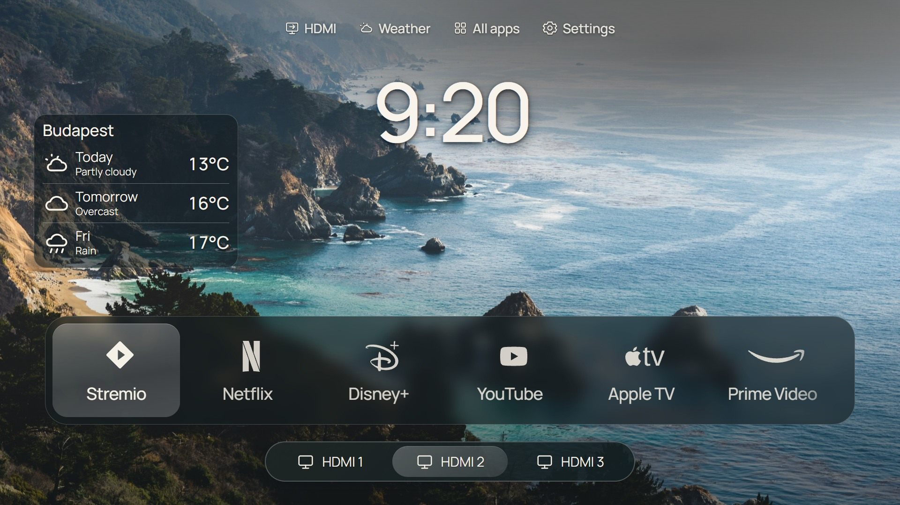
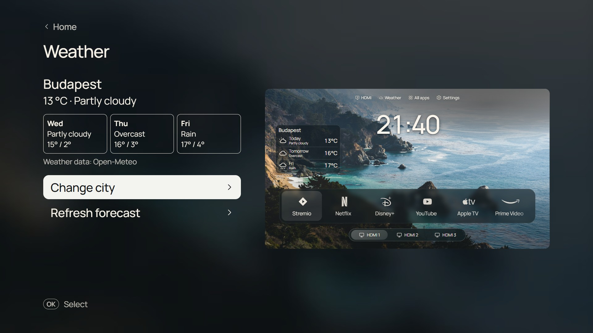

# CleanFrame for Samsung Tizen 5.0

An independent adaptation of **[CleanFrame by Nathan Clark (nthnclrk)](https://github.com/nthnclrk/CleanFrame)**, the original launcher for Samsung The Frame. This project adapts the interface for an older Samsung TV and runs as a sideloaded Tizen web application alongside Samsung Smart Hub. The original project, design, and assets are credited to their respective authors.

[Download v0.7.7](https://github.com/Bfarkas98/tizen5.0-samsung-tv-cleanframe/releases/tag/v0.7.7) · [Install on your TV](samsung/cleanframe/README.md) · [Give this guide to an AI agent](AGENTS.md) · [Compatibility and test results](docs/COMPATIBILITY.md)

## What's included

- A remote-friendly app dock with a top menu and a large 24-hour clock.
- A three-day Celsius forecast on Home, a detailed forecast view, and an editable city. Weather requests go to Open-Meteo and the latest forecast is cached on the TV.
- A Home HDMI strip and dedicated HDMI manager with input status and switching on supported TVs.

## Screenshots

These are browser captures of the 0.7.7 interface using sample weather and simulated HDMI devices. Installed apps and HDMI inputs vary by TV.

| HDMI manager | Three-day forecast |
| --- | --- |
|  |  |

## Compatibility

Samsung's developer tools confirmed installation and launch on a **UE43RU7102KXXH** running **Tizen 5.0** and firmware **T-MSLDEUC-1500.9**. HDMI switching and weather have browser test coverage. On-device behavior and support across other models may vary. See the [compatibility table](docs/COMPATIBILITY.md) for feature-by-feature results and a link to report your model.

## Source and credits

The [0.7.7 patch and build script](samsung/cleanframe/) use a pinned upstream CleanFrame snapshot and only the public font assets. See [the upstream MIT license](samsung/cleanframe/LICENSE) and [third-party notices](samsung/cleanframe/THIRD_PARTY_NOTICES.md).

## Earlier Samsung TV OS experiments

| Stage | Archived result |
| --- | --- |
| Debian appliance | Graphical media shell, writable data image support, remote navigation, playback and opt-in key-only SSH. Source and rebuild commands are in [the appliance guide](APPLIANCE.md). |
| Coast for Tizen | Remote-focused launcher source and browser simulation in [tizen](tizen/). See [build and deployment notes](docs/DEPLOYMENT.md). |
| CleanFrame | Local 0.7.7 was installed and launched on the Samsung TV. It includes a centered 24-hour clock, three-day weather panel, and HDMI manager and shortcuts. See [the CleanFrame record](docs/CLEANFRAME-TV.md). |

The earlier Debian appliance targets PCs and virtual machines. See the [appliance guide](APPLIANCE.md) or [research notes](docs/RESEARCH.md) for that work.
